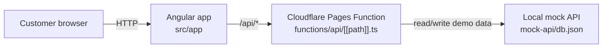

# Angular QR Code Restaurant [](https://github.com/delitamakanda/angular-qrcode-restaurant/actions/workflows/ci.yml)

Angular application for restaurant ordering via QR code. The project simulates the main customer journey: choosing an order mode, browsing the menu, customizing a product, reviewing the cart, submitting checkout information, and confirming an order, with a mock API available locally or through Cloudflare Pages Functions.

## QRCODE


Regénérer le QR code localement (sans service tiers) : `npm run qrcode` (ou `npm run qrcode -- <url>` pour une autre URL).

## Features

- restaurant landing page with order mode selection (`dine_in`, `take_away`, `delivery`)
- product catalog with category filtering and search
- product customization with modifier groups and options
- cart management and total calculation
- checkout flow with customer details, payment method, and coupon code
- order confirmation with access to the tracking page
- mock API backed by `mock-api/db.json` and exposed under `/api/*`

## Tech stack

- Angular 21 with standalone components
- Angular Signals for application state
- Taiga UI for part of the interface
- `json-server` for the local mock API
- Cloudflare Pages Functions to serve the frontend and mock API from one project

## Repository structure

```text
.
├── functions/api/[[path]].ts   # Cloudflare Pages-compatible mock API
├── mock-api/                   # local data and json-server configuration
├── public/                     # static files (_redirects, images...)
└── src/app/                    # Angular application
```

## Architecture Diagram



## Prerequisites

- Node.js 20+
- npm 11+

## Installation

```bash
npm ci
cd mock-api && npm ci
```

## Run locally

1. Start the mock API in a first terminal:

   ```bash
   cd mock-api
   npm start
   ```

2. From the project root, start the Angular application in a second terminal:

   ```bash
   npm start
   ```

3. Open `http://localhost:4200/`.

The Angular dev server proxies `/api` requests to `http://localhost:3000` through `proxy.conf.json`.

## Available flow

The default route redirects to:

```text
/store/demo/welcome
```

Main routes:

- `/store/:storeId/welcome`
- `/store/:storeId/menu`
- `/store/:storeId/cart`
- `/store/:storeId/checkout`
- `/store/:storeId/confirmation/:orderId`
- `/store/:storeId/tracking/:orderId`

## Mock data and API

Demo data is defined in `mock-api/db.json`.

Available resources:

- `GET /api/stores/:id`
- `GET /api/categories?store_id=demo&sort=sort_order`
- `GET /api/menus?store_id=demo`
- `GET /api/menus/:id`
- `GET /api/groups?menu_item_id=...`
- `GET /api/options?group_id=...`
- `GET /api/orders/:id`
- `POST /api/orders`

- `GET /api/<stores|categories|menus|groups|options|promotions>/:id` and the matching list endpoints

> Orders created locally are kept in memory only while the mock process is running.

### Local vs deployed parity

The Cloudflare Function (`functions/api/_handler.ts`, wrapped by `functions/api/[[path]].ts`) bundles `db.json` at build time: **any change to `mock-api/db.json` only shows up on Cloudflare Pages after a new deployment**. The service worker may also keep `/api/categories` (24h) and `/api/menus` (1h) responses; unregister it or clear site data to rule out stale cache.

#### Order persistence (Cloudflare D1)

On Cloudflare, `POST /api/orders` is stored in a D1 database bound as `ORDERS_DB` (`wrangler.toml`); the seed orders from `db.json` stay readable and are merged with the persisted ones. Without the binding (tests, `wrangler pages dev` without config) the Function falls back to in-memory storage. One-time setup by a maintainer:

```bash
npx wrangler d1 create angular-qrcode-restaurant-orders   # copy the database_id into wrangler.toml and uncomment the [[d1_databases]] block
npx wrangler d1 migrations apply angular-qrcode-restaurant-orders --remote
npx wrangler d1 migrations apply angular-qrcode-restaurant-orders --local   # for `wrangler pages dev`
```

To compare both environments (needs `jq`, mock API running on `:3000`):

```bash
for q in "categories?store_id=demo&_sort=sort_order" "menus?store_id=demo"; do
  diff <(curl -s "http://localhost:3000/$q" | jq -S .) \
       <(curl -s "https://angular-qrcode-restaurant.pages.dev/api/${q/_sort/sort}" | jq -S .) && echo "OK $q"
done
```

`src/app/core/api/api-parity.spec.ts` checks the Function against `db.json` for every request issued by `core/api`.

## Useful commands

```bash
npm start                     # start the Angular frontend
npm run format               # format files with Prettier
npm run format:check         # check formatting with Prettier
npm run build                 # create a production build
npx ng test --watch=false     # run Angular/Vitest unit tests
```

## Agentic workflow

Issues are used as specs: a Claude agent refines them into specifications, implements one ticket at a time and opens a pull request for human review, while a GitHub Project board is kept in sync. See [docs/agentic-workflow.md](docs/agentic-workflow.md) for the lifecycle, labels and one-time setup.

## Deploy to Cloudflare Pages

The repository is ready to serve both the frontend and the mock API from a single Cloudflare Pages project.

- **Build command**: `npm run build`
- **Build output directory**: `dist/angular-qrcode-restaurant/browser`
- **Function**: `functions/api/[[path]].ts`
- **Redirects**: `public/_redirects`

## Additional resources

- Angular CLI: <https://angular.dev/tools/cli>
- Cloudflare Pages Functions: <https://developers.cloudflare.com/pages/functions/>
