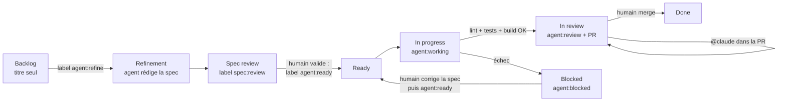

# Workflow agentique : des issues au board, du ticket à la PR

Les issues GitHub servent de specs. Un agent Claude (via
[`anthropics/claude-code-action`](https://github.com/anthropics/claude-code-action))
les transforme en spécifications, les implémente une par une et ouvre une pull
request. **Rien n'est mergé sans validation humaine.**

## Cycle de vie d'un ticket

| Étape                 | Qui     | Déclencheur                                                                              | Ce qui se passe                                                                                                                                                                                                                                                                                                                    |
| --------------------- | ------- | ---------------------------------------------------------------------------------------- | ---------------------------------------------------------------------------------------------------------------------------------------------------------------------------------------------------------------------------------------------------------------------------------------------------------------------------------- |
| Raffinement           | Agent   | label `agent:refine` (ou lancement manuel sur une liste d'issues / une épic entière)     | L'agent lit le ticket, l'épic parente, les tickets voisins et le code, puis remplace le corps de l'issue par une spec (contexte, critères d'acceptation, impact technique, plan de test, hors périmètre, questions ouvertes, estimation). Label → `spec:review`.                                                                   |
| Validation de la spec | **Toi** | —                                                                                        | Tu relis, corriges le corps de l'issue, tranches les questions ouvertes, puis poses `agent:ready`.                                                                                                                                                                                                                                 |
| Implémentation        | Agent   | label `agent:ready`, lancement manuel, ou toutes les 3 h (prochain ticket `agent:ready`) | Un ticket à la fois. Branche `agent/issue-<n>-<slug>`, implémentation + tests, puis vérification par le workflow (`lint`, `ng test`, `ng build`, `format:check`). PR ouverte avec `Closes #n`, revue demandée à la propriétaire du dépôt. Label → `agent:review`. Si une vérification échoue : PR **brouillon** + `agent:blocked`. |
| Revue                 | **Toi** | —                                                                                        | Tu relis la PR. Pour des corrections, commente `@claude …` (commentaire général, de ligne ou de revue) : l'agent pousse sur la même branche.                                                                                                                                                                                       |
| Validation            | **Toi** | merge                                                                                    | La PR ferme l'issue → `Done`.                                                                                                                                                                                                                                                                                                      |

Garde-fous :

- Les épics (issues avec sous-tickets) ne sont jamais implémentées directement :
  pose `agent:ready` sur leurs sous-tickets.
- Un ticket `agent:ready` sans section « Critères d'acceptation » repart
  automatiquement en raffinement.
- L'agent ne voit que le ticket, l'épic et les commentaires des mainteneurs
  (le dépôt est public : les commentaires de tiers sont écartés pour éviter
  l'injection de prompt). Il n'a pas accès au réseau ni à `gh`, et ne peut
  lancer que lint / tests / build / prettier.
- Toute modification de `.github/` par l'agent est annulée avant le commit, et
  c'est le workflow, pas l'agent, qui commit, pousse et ouvre la PR.

## Le board

`agent-board.yml` range chaque issue dans une colonne du champ **Status** de
ton GitHub Project selon ses labels :

| Label / état    | Colonne (noms acceptés)                                          |
| --------------- | ---------------------------------------------------------------- |
| aucun           | Backlog / Todo (uniquement si la carte n'a pas encore de statut) |
| `agent:refine`  | Refinement                                                       |
| `spec:review`   | Spec review                                                      |
| `agent:ready`   | Ready                                                            |
| `agent:working` | In progress                                                      |
| `agent:review`  | In review                                                        |
| `agent:blocked` | Blocked                                                          |
| fermée          | Done                                                             |

Un déplacement manuel d'une carte sans label agent n'est jamais écrasé. Si une
colonne n'existe pas, la carte reste où elle est (un avertissement est loggé).
Le premier lancement manuel importe tout le backlog existant dans le board.

## Installation (une fois)

1. **App Claude GitHub** : installe <https://github.com/apps/claude> sur ce
   dépôt (ou lance `/install-github-app` dans Claude Code).
2. **Authentification Claude** : ajoute dans _Settings → Secrets and variables →
   Actions_ l'un des deux secrets :
   - `ANTHROPIC_API_KEY` (clé API, facturée à l'usage), ou
   - `CLAUDE_CODE_OAUTH_TOKEN` (abonnement Claude, généré avec
     `claude setup-token`).
3. **PR créées par Actions** : _Settings → Actions → General → Workflow
   permissions_ → coche **Allow GitHub Actions to create and approve pull
   requests**.
4. **Labels** : `GH_REPO=delitamakanda/angular-qrcode-restaurant bash scripts/agent/setup-labels.sh`
5. **Board** :
   - Dans le projet, ajoute au champ **Status** les colonnes : `Backlog`,
     `Refinement`, `Spec review`, `Ready`, `In progress`, `In review`,
     `Blocked`, `Done`.
   - Crée un PAT classique avec les scopes `repo` et `project`, enregistre-le
     dans le secret `AGENT_PROJECT_TOKEN`.
   - Ajoute la variable `AGENT_PROJECT_NUMBER` (le numéro dans l'URL du projet,
     `…/users/delitamakanda/projects/<n>`). `AGENT_PROJECT_OWNER` est
     facultative (par défaut : le propriétaire du dépôt).
   - Lance _Actions → Agent – board → Run workflow_ (d'abord avec `dry_run`)
     pour importer toutes les issues.
6. **Modèle** (facultatif) : variable `AGENT_MODEL` (`sonnet` par défaut,
   `opus` pour des tickets plus complexes).

## Utilisation au quotidien

- Raffiner une épic entière : _Actions → Agent – raffinement → Run workflow_,
  champ `epic` = numéro de l'épic (ex. `83` pour Tracking).
- Implémenter un ticket précis tout de suite : _Actions → Agent –
  implémentation → Run workflow_, champ `issue`.
- Débloquer un ticket `agent:blocked` : corrige la spec ou la PR, retire
  `agent:blocked` et repose `agent:ready`.

## Fichiers

| Fichier                                 | Rôle                                          |
| --------------------------------------- | --------------------------------------------- |
| `.github/workflows/agent-refine.yml`    | Raffinement des tickets en specs              |
| `.github/workflows/agent-implement.yml` | Implémentation + PR                           |
| `.github/workflows/agent-review.yml`    | Retours de revue via `@claude`                |
| `.github/workflows/agent-board.yml`     | Synchronisation du board                      |
| `.github/agent/prompts/*.md`            | Instructions des agents (à ajuster librement) |
| `scripts/agent/prepare-issue.mjs`       | Contexte du ticket fourni à l'agent           |
| `scripts/agent/board-sync.mjs`          | Labels → colonnes du GitHub Project           |
| `scripts/agent/setup-labels.sh`         | Création des labels                           |
| `.github/ISSUE_TEMPLATE/spec.yml`       | Formulaire d'issue au format spec             |
